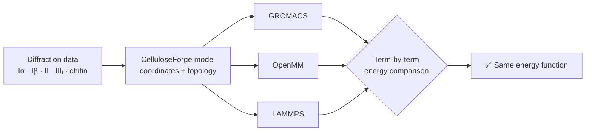

<div align="center">

# CelluloseForge

### Crystallography-first builder for simulation-ready cellulose and chitin crystals, verified to give the same energy in every MD engine

[](https://github.com/askforarun/cellulose-forge/actions/workflows/ci.yml)
[](#requirements)
[](LICENSE)
[](#-cross-engine-validation-one-model-one-energy)
[](#-cross-engine-validation-one-model-one-energy)

[Quick start](#quick-start) ·
[Cross-engine validation](#-cross-engine-validation-one-model-one-energy) ·
[Full tutorial](docs/tutorial.md) ·
[Validation details](#validation) ·
[Common errors](#common-errors)

</div>


CelluloseForge builds atomistic crystalline polysaccharide structures directly
from primary diffraction data: cellulose and chitin crystals, coordinate-only
Mannan I crystals, chain-parallel surface slabs, and literature-defined
fibrils. It parameterizes them with GLYCAM06j-1 or CHARMM36, or with
experimental OpenFF Sage 2.3, OPLS-AA or OPLS-AA-SEI. It then writes them for
GROMACS, OpenMM, LAMMPS and (for finite GLYCAM chains) Amber, and checks that
every engine evaluates the **same energy** for the same model.

> [!IMPORTANT]
> ## 🚀 New in 1.2.0, now on PyPI
>
> `pip install cellulose-forge`. This release adds **OpenMM output** for GLYCAM06j-1 and CHARMM36
> with finite or covalently periodic chains; **native Amber output** for finite
> GLYCAM chains; experimental **LAMMPS output**; **CHARMM36 chitin**;
> coordinate-only **Mannan I**; I-beta **18- and 24-chain fibril presets** and
> **custom I-beta fibril profiles**; an experimental **OpenFF Sage 2.3**
> backend; experimental **OPLS-AA and OPLS-AA-SEI** for GROMACS, OpenMM and
> LAMMPS; **cross-engine energy validation** for every force field; and
> starting **run inputs for every engine**. **CHARMM/PSF output** and
> **odd-DP chains** remain planned. Feedback and
> contributions are welcome.

> **Release status:** CelluloseForge 1.2.0 is the current stable release. Its
> supported and validated boundaries are intentionally narrower than the
> long-term project plan. Every supported combination is validated as
> described in [Validation](#validation).

## ✨ Why CelluloseForge?

| | |
|---|---|
| 🔬 **The experimental crystal, exactly** | Cellulose I-alpha, I-beta, II and III-I, and alpha- and beta-chitin, built from primary diffraction data with full triclinic symmetry. The configuration of every stereocentre is checked on every build. |
| 🧱 **Any crystalline geometry** | Periodic bulk crystals, chain-parallel slabs from signed Miller indices, 36-chain fibrils, and I-beta 18- and 24-chain presets and custom row profiles. Chains can be finite or covalently periodic. |
| ⚙️ **Five force fields** | GLYCAM06j-1 (via AmberTools) and CHARMM36 (read directly, no VMD or `psfgen`), plus experimental OpenFF Sage 2.3, OPLS-AA and OPLS-AA-SEI. |
| 🖥️ **Four engines** | GROMACS, OpenMM, LAMMPS and Amber, each with starting minimization and smoke-test run inputs. |
| ✅ **Verified, not just converted** | Topologies are compared with independent reference tools, and energies term by term across engines, down to 10⁻⁶ ([details](#-cross-engine-validation-one-model-one-energy)). |
| 🔁 **Reproducible by design** | Deterministic chain and residue numbering, byte-identical rebuilds, and a machine-readable build report. Every validation result records the commit and software versions that produced it. |
| 🤖 **Automation-ready** | One scriptable CLI and an importable package, with explicit errors and JSON diagnostics for workflow managers and LLM-based agents. Automatic mmCIF output above 99,999 atoms. |

## 🎯 Cross-engine validation: one model, one energy

A topology that every engine accepts can still encode a **different energy
function**: 1-4 scaling, exclusions, switching functions, Ewald conventions
and periodic images are each handled differently by different programs.
CelluloseForge therefore evaluates the *same* model in every engine and
compares the energies **term by term**: bonds, angles, torsions, 1-4 pairs,
Lennard-Jones, Coulomb and the total.



| Force field | Engines compared | Systems | Measured agreement |
|---|---|---|---|
| GLYCAM06j-1, CHARMM36 (cellulose) | OpenMM vs GROMACS | Periodic slabs of all four allomorphs, a finite I-beta slab, and an I-beta bulk crystal | Bonded and 1-4: ≤ 8 × 10⁻⁶ relative · total nonbonded: ≤ 1.3 × 10⁻⁴ |
| CHARMM36 (cellulose) | LAMMPS vs GROMACS and OpenMM | I-beta, I-alpha, II slabs | Total ≤ 2.7 × 10⁻⁵ after three documented LAMMPS conventions · bonded and 1-4 within 0.2 kJ/mol |
| CHARMM36 (chitin) | OpenMM and LAMMPS vs GROMACS | Alpha and beta, finite and periodic (1 0 0) slabs | Bonded within 0.03 kJ/mol · nonbonded totals within 0.7 kJ/mol |
| OPLS-AA, OPLS-AA-SEI *(experimental)* | OpenMM and LAMMPS vs **double-precision** GROMACS | 36 systems: slabs, bulk crystals and fibrils of every allomorph | Bonded, pair and Lennard-Jones terms ≤ 10⁻⁶ · Coulomb and totals ≤ 3 × 10⁻⁶ |
| OpenFF Sage 2.3 *(experimental)* | OpenMM vs GROMACS | Slabs, bulk crystals and fibrils of every supported allomorph | Within the documented mixed-precision criterion, max(10⁻⁵, 4 ε₃₂ √N) |

**What the comparisons caught.** Files that "just work" would have hidden each
of these:

- 🔎 **LAMMPS CHARMM conventions.** Three documented offsets (the CHARMM
  Coulomb constant, constant 1-4 offsets of `dihedral_style charmmfsw`, and the
  vfswitch/force-switch shift) account for almost all of a raw 2 × 10⁻⁴ gap
  ([`docs/lammps.md`](docs/lammps.md)).
- 🔎 **An OpenMM Reference-platform discrepancy.** For boxes whose third vector
  is tilted (I-alpha bulk), OpenMM 8.6.1's Reference platform disagreed with an
  exact nearest-image sum by 0.14--0.40 %, so the CPU platform is used there
  ([`validation/measure_openmm_tilted_box.py`](validation/measure_openmm_tilted_box.py)).
- 🔎 **GROMACS pair-list buffers.** `grompp` rejects boxes only just above
  twice the cutoff, so CelluloseForge requires a 0.5 Å margin on each side
  ([Periodic box size](#periodic-box-size)).
- 🔎 **Coordinate rounding.** GRO files round positions to 0.001 nm, which
  places pairs exactly on the cutoff, so the OPLS comparison uses unrounded
  coordinates ([`validation/README.md`](validation/README.md)).

> Validation establishes that each model is **built and translated
> correctly**. It does not assess how well a force field reproduces cellulose;
> see [What is not validated](#what-is-not-validated).

## Current support

| Structure | Polymers and allomorphs | Force-field output |
|---|---|---|
| Unit cell | Cellulose I-alpha, I-beta, II, III-I; alpha- and beta-chitin; Mannan I | Coordinate-only: a single cell is narrower than twice any force-field cutoff, so use a periodic bulk crystal for force-field output |
| Periodic bulk | Cellulose I-alpha, I-beta, II, III-I; alpha- and beta-chitin; Mannan I | GLYCAM06j-1 and CHARMM36 (cellulose and chitin), plus experimental OpenFF Sage, OPLS-AA and OPLS-AA-SEI (cellulose); coordinate-only (Mannan I) |
| Slab | Chain-parallel faces of the four cellulose allomorphs and of alpha- and beta-chitin | GLYCAM06j-1 and CHARMM36 (cellulose and chitin), plus experimental OpenFF Sage, OPLS-AA and OPLS-AA-SEI (cellulose) |
| 36-chain fibril | Cellulose I-alpha, I-beta, II | GLYCAM06j-1, CHARMM36 and experimental OpenFF Sage, OPLS-AA and OPLS-AA-SEI |
| 18- and 24-chain fibril, custom profiles (`main`) | Cellulose I-beta | GLYCAM06j-1, CHARMM36 and experimental OpenFF Sage, OPLS-AA and OPLS-AA-SEI |

Simulation engines by force field and chain boundary:

| Engine | GLYCAM06j-1 | CHARMM36 | OpenFF Sage (experimental) | OPLS-AA, OPLS-AA-SEI (experimental) | Status |
|---|---|---|---|---|---|
| GROMACS | Finite and periodic | Finite and periodic | Finite and periodic | Finite and periodic | Released |
| OpenMM | Finite and periodic | Finite and periodic | Finite and periodic | Finite and periodic | Released (1.2.0) |
| LAMMPS | Finite and periodic | Finite and periodic | Not available | Finite and periodic | Experimental (1.2.0) |
| Amber | Finite only | Not available | Not available | Not available | Released (1.2.0) |

Native Amber output cannot represent covalently periodic chains because Amber
does not minimum-image bonded terms across the box boundary; use GROMACS or
OpenMM for those. The software excludes functionalization, native CHARMM/PSF
output, and arbitrary branched glycans.

## Table of contents

- [Why CelluloseForge?](#-why-celluloseforge)
- [Cross-engine validation](#-cross-engine-validation-one-model-one-energy)
- [Current support](#current-support)
- [Requirements](#requirements)
- [Installation](#installation)
- [Verify the installation](#verify-the-installation)
- [Quick start](#quick-start)
- [Chitin and mannan](#chitin-and-mannan)
- [Force-field workflows](#force-field-workflows)
- [Output files and run inputs](#output-files-and-run-inputs)
- [Command reference](#command-reference)
- [Large systems](#large-systems)
- [Scientific conventions](#scientific-conventions)
- [Validation](#validation)
- [Common errors](#common-errors)
- [Full tutorial](#full-tutorial)
- [Workflow-manager and LLM-agent orchestration](#workflow-manager-and-llm-agent-orchestration)
- [Development and testing](#development-and-testing)

## Requirements

### Coordinate-only builds

- Python 3.11, 3.12, or 3.13
- NumPy 1.26 or newer, below 2.3

### GLYCAM/GROMACS builds

In addition to the coordinate-only requirements:

- AmberTools with `tleap`
- GLYCAM06j-1, distributed with AmberTools as `leaprc.GLYCAM_06j-1`
- ParmEd
- GROMACS for preprocessing, minimization, and simulation

AmberTools and ParmEd are not required when `--force-field none` is used.
GROMACS is not required to generate files, but it is required to validate and
simulate the generated system.

### CHARMM36/GROMACS builds

In addition to the coordinate-only requirements:

- Internet access for the one-time force-field download, or a local copy of
  the official pinned archive
- GROMACS for preprocessing, minimization, and simulation

AmberTools, ParmEd, VMD, and `psfgen` are not required for CHARMM36 builds.
CelluloseForge reads the official GROMACS CHARMM36 files directly.

### OpenMM, LAMMPS, OpenFF Sage and OPLS builds

- OpenMM output (and GLYCAM and CHARMM36 LAMMPS output, which is converted
  through OpenMM) requires the `openmm` Python package.
- OPLS-AA and OPLS-AA-SEI need no extra packages for GROMACS and LAMMPS
  output; their OpenMM output needs `openmm`.
- Experimental OpenFF Sage builds require the separate conda environment in
  `environment-openff.yml` (OpenFF Toolkit, Interchange, NAGL and OpenMM).
  AmberTools is not required.

## Installation

### Install from PyPI

```bash
python -m pip install cellulose-forge
cellulose-forge --help
```

This installs the coordinate builder and the CHARMM36, OPLS-AA and
OPLS-AA-SEI backends, which need only NumPy (CHARMM36 also needs a one-time
`cellulose-forge forcefield install charmm36`). GLYCAM06j-1 additionally needs
AmberTools and ParmEd, OpenMM output needs `openmm`
(`pip install "cellulose-forge[openmm]"`), and OpenFF Sage needs the conda
environment described below. To work from the source repository instead, use
one of the following.

### Coordinate-only installation with uv

```bash
git clone https://github.com/askforarun/cellulose-forge.git
cd cellulose-forge
uv sync
uv run cellulose-forge --help
```

Install [uv](https://docs.astral.sh/uv/getting-started/installation/) first if
the `uv` command is unavailable.

### Coordinate-only installation with pip

```bash
git clone https://github.com/askforarun/cellulose-forge.git
cd cellulose-forge
python -m venv .venv
source .venv/bin/activate
python -m pip install --upgrade pip
python -m pip install -e .
cellulose-forge --help
```

On Windows PowerShell, activate the environment with
`.venv\Scripts\Activate.ps1`.

### Recommended GLYCAM installation

The repository provides an `environment.yml` containing CelluloseForge,
AmberTools, and ParmEd.
Create it from the repository root:

```bash
git clone https://github.com/askforarun/cellulose-forge.git
cd cellulose-forge
conda env create -f environment.yml
conda activate cellulose-forge
cellulose-forge doctor
```

AmberTools supplies `antechamber`, `parmchk2`, and `tleap`; the current GLYCAM
adapter uses `tleap`, while ParmEd converts and writes the matched GROMACS
topology. The editable package entry in `environment.yml` installs the local
CelluloseForge checkout, so run `conda env create` from the repository root.
GROMACS is not installed by this environment; install it separately when
preprocessing or simulation validation is required.

To update an existing environment after the file changes:

```bash
conda env update -n cellulose-forge -f environment.yml --prune
```

Users who only need coordinate generation or CHARMM36 construction may use the
lighter `uv` or `pip` installation above instead.

### Install the CHARMM36 force field

After installing CelluloseForge, download and install the supported official
CHARMM36/CGenFF release:

```bash
cellulose-forge forcefield install charmm36
```

When using the `uv` environment from this repository, run:

```bash
uv run cellulose-forge forcefield install charmm36
```

The installer downloads the pinned February 2026 CHARMM36/CGenFF 5.0 GROMACS
archive from the MacKerell Laboratory, verifies its SHA-256 checksum, validates
the required files, and installs it under the user data directory. Confirm the
exact path with:

```bash
cellulose-forge forcefield path charmm36
```

For an offline machine or compute cluster, first obtain the same official
archive and install from the local file:

```bash
cellulose-forge forcefield install charmm36 \
  --archive /path/to/charmm36-feb2026_cgenff-5.0.ff.tgz
```

Set `CELLULOSE_FORGE_DATA_DIR` before installation if the default
`~/.local/share/cellulose-forge` location is unsuitable. Normal builds discover
this installed release automatically; `--charmm-force-field-directory` is only
needed to override discovery deliberately.

### Install the experimental OpenFF Sage environment

```bash
conda env create -f environment-openff.yml
conda activate cellulose-forge-openff
```

The environment pins OpenFF Toolkit, Interchange, NAGL, the NAGL model
package, and OpenMM. Without it, `--force-field openff` exits with an
installation message.

### Check external tools

Verify the external tools with one diagnostic command:

```bash
cellulose-forge doctor
```

`doctor` checks Python, NumPy, `tleap`, ParmEd, OpenMM, LAMMPS, and GROMACS,
reports which build modes are ready, and suggests a fix for anything missing.
Pass `--json` for machine-readable output. GROMACS is commonly installed
separately using the package manager or module system appropriate to the
workstation or cluster. Consult the
[GROMACS installation guide](https://manual.gromacs.org/current/install-guide/index.html).

If ParmEd is installed in a different Python environment, pass its interpreter
with `--parmed-python /path/to/python` to both `doctor` and `build`. Likewise,
a non-default `tleap` can be selected with `--tleap-executable /path/to/tleap`,
and OpenMM in another interpreter with `--openmm-python /path/to/python`.

## Verify the installation

```bash
cellulose-forge --version
cellulose-forge build --help
```

For a source checkout with development dependencies:

```bash
uv sync --extra dev
uv run pytest
uv run ruff check .
uv run mypy src
```

## Quick start

### Unit cell

```bash
cellulose-forge build \
  --allomorph I-beta \
  --shape unit-cell \
  --output ibeta_unit_cell.pdb
```

### Periodic bulk crystal

The values supplied to `--cells` are repetitions along the crystallographic
`a`, `b`, and `c` axes. Bulk geometry contains complete crystallographic unit
cells.

```bash
cellulose-forge build \
  --allomorph I-beta \
  --shape bulk \
  --cells 4 4 5 \
  --output ibeta_4x4x5_bulk.pdb
```

### I-beta `(110)` slab using exact counts

Degree of polymerization is the number of anhydroglucose units in each chain.
The current slab builder requires an even value. I-beta `(110)` slabs also
require an even `--chains-per-layer` so the transverse periodic box contains a
complete origin/center-chain lattice repeat. Dimension-based width requests
round upward to the next even chain count automatically.

```bash
cellulose-forge build \
  --allomorph I-beta \
  --shape slab \
  --face 1 1 0 \
  --layers 4 \
  --chains-per-layer 20 \
  --degree-polymerization 12 \
  --chain-boundary finite \
  --vacuum 30 \
  --output ibeta_110_slab.pdb
```

> **Finite-chain simulation boxes require longitudinal padding.** The
> `--vacuum` option pads the slab-normal direction; it does not separate the
> chemically capped chain ends from their periodic images. Before using a
> finite slab with GROMACS, supply at least 3 Å of chain-direction padding with
> `--padding-longitudinal` (for example, `--padding-longitudinal 20`). Without it, terminal atoms can
> overlap their periodic images and produce catastrophically large nonbonded
> energies. Values below 12 Å produce a warning because the ends may remain
> within a typical nonbonded cutoff; validated examples use 12--20 Å. Periodic
> chains must instead use zero longitudinal padding because
> their final and first residues are intentionally bonded across the box.

### I-beta `(110)` slab using physical dimensions

Dimensions are specified in angstrom. CelluloseForge rounds upward to complete
chains, molecular layers, and cellobiose repeats, and records the realized
dimensions in the output metadata.

```bash
cellulose-forge build \
  --allomorph I-beta \
  --shape slab \
  --face 1 1 0 \
  --slab-width 120 \
  --slab-thickness 25 \
  --slab-length 60 \
  --chain-boundary periodic \
  --vacuum 30 \
  --output ibeta_110_sized_slab.pdb
```

Sizing is selected independently for each axis. Supply exactly one option from
each pair: `--chains-per-layer` or `--slab-width`, `--layers` or
`--slab-thickness`, and `--degree-polymerization` or `--slab-length`. This
allows hybrid requests such as four exact layers with minimum 40 Å width and
40 Å chain length:

```bash
cellulose-forge build \
  --allomorph I-beta --shape slab --face 1 1 0 \
  --layers 4 --slab-width 40 --slab-length 40 \
  --chain-boundary finite --vacuum 30 \
  --output ibeta_110_hybrid.pdb
```

### Fibril cross-sections

```bash
cellulose-forge build \
  --allomorph I-beta \
  --shape fibril \
  --fibril-model 36-chain \
  --degree-polymerization 12 \
  --chain-boundary periodic \
  --vacuum 30 \
  --output ibeta_36chain_dp12.pdb
```

The preset is an explicit published chain arrangement, not an ideal regular
hexagon. Cellulose III-I has no supported 36-chain reference preset.

The development branch also provides I-beta 18- and 24-chain profiles:

```bash
cellulose-forge build \
  --allomorph I-beta --shape fibril \
  --fibril-model 18-chain \
  --degree-polymerization 12 --chain-boundary periodic \
  --vacuum 30 --output ibeta_18chain_dp12.pdb
```

The 18-chain profile is `2,3,4,4,3,2`; the 24-chain profile is
`3,4,5,5,4,3`. Rows are listed from low to high Cartesian `z`. A custom
profile within the validated I-beta 36-chain lattice envelope can be supplied
directly:

```bash
cellulose-forge build \
  --allomorph I-beta --shape fibril \
  --fibril-profile 1,2,3,2,1 \
  --degree-polymerization 12 --chain-boundary periodic \
  --vacuum 30 --output ibeta_custom_dp12.pdb
```

The 18-/24-chain and custom-profile paths currently support I-beta only. A
custom row list is a geometric request and is not described as a
literature-defined fibril unless its exact arrangement has a cited source.

For independent transverse box control, use `--padding-x` for Cartesian `x`
and `--padding-y` for the second transverse direction, Cartesian `z`. Both
values are total padding and are divided equally between opposite sides. For a
finite fibril, `--padding-longitudinal` controls total padding beyond the
chain ends along the chain axis:

```bash
cellulose-forge build \
  --allomorph I-beta \
  --shape fibril \
  --fibril-model 36-chain \
  --degree-polymerization 12 \
  --chain-boundary finite \
  --padding-x 30 \
  --padding-y 40 \
  --padding-longitudinal 20 \
  --output ibeta_36chain_finite_padded.pdb
```

For periodic chains, the y box length is fixed by the crystallographic repeat;
nonzero `--padding-longitudinal` is rejected because it would break the covalent bond
across the boundary. `--vacuum N` remains a shorthand that applies `N` total
padding to both transverse directions unless the corresponding option
overrides it. The historical `--padding-z` spelling is accepted as a
deprecated alias.

## Chitin and mannan

### Chitin

`--polymer chitin` builds alpha- and beta-chitin unit cells, periodic bulk
crystals, and chain-parallel slabs:

```bash
cellulose-forge build --polymer chitin --allomorph alpha \
  --shape bulk --cells 4 2 3 --output alpha_chitin.pdb
```

The alpha-chitin structure (P2<sub>1</sub>2<sub>1</sub>2<sub>1</sub>, 293 K) is
from Sikorski, Hori and Wada, *Biomacromolecules* 2009, 10, 1100-1105
(doi:10.1021/bm801251e); its disordered hydroxymethyl group is selected with
`--o6-conformation major|minor`. Anhydrous beta-chitin (P2<sub>1</sub>, setting P 1 1 2<sub>1</sub>, 293 K) is from
Nishiyama, Noishiki and Wada, *Macromolecules* 2011, 44, 950-957
(doi:10.1021/ma102240r). Residues are written as `NAG`, and every residue's
C1-C5 configuration is checked against N-acetyl-beta-D-glucosamine.

Chitin slabs use the same general reciprocal-lattice construction as cellulose,
for any `(h k 0)` face and finite or periodic chains:

```bash
cellulose-forge build --polymer chitin --allomorph beta --shape slab \
  --face 1 0 0 --layers 3 --chains-per-layer 4 --degree-polymerization 6 \
  --chain-boundary periodic --vacuum 20 --output beta_chitin_100.pdb
```

`--force-field charmm36` builds chitin with the CHARMM36 `BGLCNA` residue,
linked by the `14bb` patch, for GROMACS and, with `--md-engine openmm` or
`--md-engine lammps`, for OpenMM and LAMMPS:

```bash
cellulose-forge build --polymer chitin --allomorph beta --shape slab \
  --face 1 0 0 --layers 3 --chains-per-layer 4 --degree-polymerization 6 \
  --chain-boundary periodic --vacuum 20 --force-field charmm36 --output beta_chitin_100
```

The output directory contains `chitin_charmm36.itp` (cellulose keeps
`cellulose_charmm36.itp`), `system.top`, `structure.gro`, the run inputs, and
a local `charmm36.ff`. Each residue carries the two acetyl impropers. Finite
chains use free-sugar termini: the reducing end keeps O1/HO1 (-0.18 e) and the
non-reducing end keeps HO4 (+0.18 e). Position restraints for chitin use the
`POSRES_CHITIN` define.

`--force-field glycam` uses the GLYCAM06j-1 `0YB`, `1YB`, and `4YB`
N-acetylglucosamine residues. GROMACS output supports finite and covalently
periodic chitin chains; native Amber output is additionally available for
finite chains. The amide H-N-C-O 1-4 interaction uses GLYCAM's distinct
SCEE=1.2 and SCNB=2.0 scaling and is written explicitly in GROMACS rather than
being forced into the unity scaling used by the carbohydrate torsions. A
finite beta-chitin slab was evaluated on identical coordinates with `sander`
and double-precision GROMACS: every bonded and 1-4 category agreed within
0.000124 kcal/mol after accounting for the engines' Coulomb constants.
OpenMM and LAMMPS output preserve the same mixed scaling for finite and
covalently periodic chains. OpenMM stores the affected pairs as native
nonbonded exceptions. LAMMPS uses explicit tabulated 1-4 corrections for only
the affected atom pairs; these are an evaluation mechanism, not additional
chemical bonds. Across alpha/beta slabs and periodic bulk crystals, bonded and
explicit-pair energies agree with double-precision GROMACS within 8.4 × 10^-6
relative difference.

```bash
cellulose-forge build --polymer chitin --allomorph beta --shape slab \
  --face 1 0 0 --layers 3 --chains-per-layer 4 --degree-polymerization 6 \
  --chain-boundary periodic --vacuum 20 --force-field glycam \
  --md-engine gromacs --md-engine openmm --md-engine lammps \
  --output beta_chitin_glycam
```

Native Amber output remains finite-chain-only. OpenFF Sage and fibrils remain
unavailable for chitin.

### Mannan

`--polymer mannan` currently builds coordinate-only Mannan I unit cells and
periodic bulk crystals:

```bash
cellulose-forge build --polymer mannan --allomorph I \
  --shape bulk --cells 4 4 5 --output mannan_i.pdb
```

The model uses the orthorhombic P2<sub>1</sub>2<sub>1</sub>2<sub>1</sub> cell
(`a = 8.92`, `b = 7.21`, `c = 10.27` A) and antiparallel two-fold helices of
Chanzy *et al.*, *Macromolecules* 1987, 20, 2407-2413
(doi:10.1021/ma00176a014). Table I supplies the non-hydroxyl coordinates and
the paper supplies the chain transforms. The tabulated O1 duplicates the
screw-related O4 glycosidic oxygen and is stored once as O4. Hydroxyl
hydrogens, absent from the table, are modelled with tetrahedral C-O-H geometry
toward acceptors in the reported hydrogen-bond network and are identified as
modelled in the package-data provenance and build report. Their coupled
torsions avoid periodic hydrogen clashes while preserving the primary heavy
atoms. The Table I O3...O5 contact is 2.385 A, shorter than later refinements;
any future force-field use must therefore begin with a restrained relaxation
of the modelled hydrogens.

Slabs and force-field output remain disabled for mannan until separately
implemented and validated. Mannan II is not yet enabled because its hydrated
four-chain atomic model and water sites must first be recovered and audited
against the primary structural source; it will not be inferred from Mannan I.

## Force-field workflows

### GLYCAM and GROMACS

Select `--force-field glycam` and provide an output directory instead of a
coordinate filename:

```bash
cellulose-forge build \
  --allomorph I-beta \
  --shape fibril \
  --fibril-model 36-chain \
  --degree-polymerization 12 \
  --chain-boundary periodic \
  --vacuum 30 \
  --force-field glycam \
  --output ibeta_fibril
```

CelluloseForge asks `tleap` to construct one GLYCAM chain, converts that
reference with ParmEd, maps the crystallographic coordinates into GLYCAM atom
order, and repeats the topology for the generated chains.

For cellulose II, the diffraction dataset does not contain hydroxyl-hydrogen
coordinates. GLYCAM and OpenFF output construct HO2, HO3, and HO6 on an exact
tetrahedral cone (0.96 A O-H, 108.5 degree C-O-H). Hydrogens are placed class
by class (HO3, HO2, HO6) so that equivalent hydroxyls are treated identically:
HO3 takes the intrachain O3-H...O5 bond present in every cellulose allomorph,
and the others take the clash-free torsion with the best geometric hydrogen
bond, otherwise the aligned force-field torsion. The experimental heavy-atom
coordinates remain unchanged; minimize before dynamics. Origin and center
chains are mapped in opposite residue directions to preserve the allomorph's
antiparallel connectivity. This construction is recorded in
`build_report.json`.

Preprocess and minimize the generated system with GROMACS:

```bash
gmx grompp \
  -f ibeta_fibril/minim.mdp \
  -c ibeta_fibril/structure.gro \
  -p ibeta_fibril/system.top \
  -o ibeta_fibril/minim.tpr

gmx mdrun -deffnm ibeta_fibril/minim
```

### CHARMM36

Install the pinned official February 2026 CHARMM36/CGenFF 5.0 GROMACS port once:

```bash
cellulose-forge forcefield install charmm36
```

Build a finite cellulose I-beta (110) slab with native CHARMM36/GROMACS
topology:

```bash
cellulose-forge build \
  --allomorph I-beta \
  --shape slab \
  --face 1 1 0 \
  --layers 4 \
  --chains-per-layer 20 \
  --degree-polymerization 12 \
  --chain-boundary finite \
  --vacuum 30 \
  --padding-longitudinal 20 \
  --force-field charmm36 \
  --output ibeta_110_charmm36
```

The output directory contains `structure.gro`, `structure.pdb` (or mmCIF for
large systems), `cellulose_charmm36.itp`, `system.top`, `minim.mdp`, `nvt.mdp`,
the pinned local force-field files, and `build_report.json`. Preprocess it with:

```bash
gmx grompp \
  -f ibeta_110_charmm36/minim.mdp \
  -c ibeta_110_charmm36/structure.gro \
  -p ibeta_110_charmm36/system.top \
  -o ibeta_110_charmm36/minim.tpr

gmx mdrun -deffnm ibeta_110_charmm36/minim
```

The installer verifies the archive checksum and records a stable local release;
upstream updates are adopted only through an explicit CelluloseForge update.
CelluloseForge reads `BGLC` from the installed force field, applies finite or
cyclic `14bb` linkages, and writes matched GRO/ITP/TOP output
directly without a reference-chain ITP, VMD, or `psfgen`. See
the [full tutorial](docs/tutorial.md#11-generate-charmm36gromacs-systems) for
finite and periodic examples and [`docs/charmm36.md`](docs/charmm36.md) for
the implementation.

### Experimental OpenFF Sage

CelluloseForge includes an optional, experimental OpenFF Sage 2.3 backend for
finite and periodic cellulose slabs and fibrils and periodic bulk crystals,
with GROMACS and OpenMM output in the same layout as GLYCAM and CHARMM36. It
constructs the molecular graph directly and assigns NAGL charges; AmberTools is
not required. Model construction is validated, but force-field accuracy for
cellulose has not been assessed.

```bash
conda activate cellulose-forge-openff
cellulose-forge build \
  --allomorph I-beta --shape fibril --fibril-model 36-chain \
  --degree-polymerization 6 --chain-boundary periodic --vacuum 20 \
  --force-field openff --md-engine gromacs --md-engine openmm \
  --output openff_ibeta_fibril
```

Chitin, mannan, Amber, LAMMPS, unit cells, finite bulk crystals, and position
restraints are rejected for OpenFF. See [`docs/openff.md`](docs/openff.md) for
the precise scope.

### Experimental OPLS-AA and OPLS-AA-SEI

`--force-field opls-aa` applies the OPLS-AA carbohydrate parameters of Damm et
al. (1997) and `--force-field opls-aa-sei` the OPLS-AA-SEI refinement of Kony
et al. (2002), which reparameterizes several torsions and divides 1-5
electrostatics within each residue by 1.26 (1-6 hydroxymethyl/C4-hydroxyl
pairs by 1.22). Both cover finite and periodic cellulose slabs and fibrils and
periodic bulk crystals, with GROMACS, OpenMM and LAMMPS output, and need no
external parameter files. The topologies are validated against the published
parameters and across the three engines; force-field accuracy for cellulose
has not been assessed.

```bash
cellulose-forge build \
  --allomorph I-beta --shape slab --face 1 1 0 \
  --layers 3 --chains-per-layer 4 --degree-polymerization 6 \
  --chain-boundary periodic --vacuum 30 \
  --force-field opls-aa-sei \
  --md-engine gromacs --md-engine openmm --md-engine lammps \
  --output opls_sei_ibeta_slab
```

In LAMMPS the SEI-scaled pairs are tabulated pseudo-bonds, so their energy
appears in `ebond`. Chitin, mannan, Amber, unit cells, finite bulk crystals
and position restraints are rejected. See [`docs/opls.md`](docs/opls.md) for
parameter sources, the three interpretations needed to apply the
monosaccharide parameters to cellulose, and each engine's representation.

### Selective chain position restraints

GLYCAM and CHARMM36 builds can apply GROMACS position restraints to the heavy
atoms of selected chains. Hydrogens remain unrestrained. Chain and
transverse-layer IDs are deterministic, one-based identifiers reported in
`build_report.json`. Select explicit chains with `--restrain-chains` or
complete layers with `--restrain-layers`. The two selectors are mutually
exclusive. For example, this one-sided four-layer slab restrains the heavy
atoms in layers 1 and 2 while layers 3 and 4 remain fully flexible:

```bash
cellulose-forge build \
  --allomorph I-beta \
  --shape slab \
  --face 1 1 0 \
  --layers 4 \
  --chains-per-layer 20 \
  --degree-polymerization 12 \
  --chain-boundary finite \
  --vacuum 30 \
  --padding-longitudinal 20 \
  --force-field glycam \
  --restrain-layers 1 2 \
  --restraint-force 1000 1000 1000 \
  --output restrained_4layer_slab
```

Slab and fibril layers are numbered from low to high Cartesian `z`. Fibril
cross-sections are displayed with the documented 90-degree counterclockwise
rotation, and their layers follow the explicit bottom-to-top rows of the
literature-defined preset. Within each fibril layer, chain IDs increase from
low to high Cartesian `x`. The generated topology separates free and restrained chains while
preserving the coordinate-to-topology order. The build report records the
layer-to-chain expansion and maps each selected chain ID to its GROMACS
molecule index and global atom range. Its `atom_selection` field records that
only heavy atoms in those chains are restrained.

The generated `minim.mdp` and `nvt.mdp` contain a commented `define` line.
Uncomment it, or add the define to your own MDP file, to enable the
restraints:

```ini
define = -DPOSRES_CELLULOSE
```

Then pass the reference coordinates with `gmx grompp -r`:

```bash
gmx grompp \
  -f restrained_4layer_slab/nvt.mdp \
  -c restrained_4layer_slab/structure.gro \
  -r restrained_4layer_slab/structure.gro \
  -p restrained_4layer_slab/system.top \
  -o restrained_4layer_slab/nvt.tpr
```

Omitting the define disables the restraints without requiring a new
structure or topology. Chitin uses `-DPOSRES_CHITIN`. The three values
supplied to `--restraint-force` are the x, y, and z force constants in
kJ mol$^{-1}$ nm$^{-2}$.

## Output files and run inputs

### Coordinate-only mode

The filename extension selects PDB or PDBx/mmCIF. Every coordinate-only build
also writes a sibling `<structure>.build_report.json` containing the interpreted
geometry, chain count, derived degree of polymerization, and actual coordinate
filename:

```text
structure.pdb
structure.build_report.json
structure.cif
structure.mmcif
```

When physical slab dimensions are requested, the report records both the
requested and realized dimensions in `geometry_annotations`. The reported DP
is the even number of anhydroglucose units obtained by rounding the requested
chain-direction length upward to complete cellobiose repeats.

### Force-field mode

```text
ibeta_fibril/
├── structure.pdb       # or structure.cif for more than 99,999 crystal atoms
├── structure.gro       # GROMACS coordinates            (--md-engine gromacs)
├── system.top          # standalone GROMACS topology
├── minim.mdp           # GROMACS minimization input
├── nvt.mdp             # GROMACS 1 ps NVT smoke test
├── system.xml          # OpenMM system                  (--md-engine openmm)
├── state.xml           # OpenMM starting state
├── topology.cif        # OpenMM topology and coordinates
├── run_openmm.py       # configurable OpenMM runner
├── system.data         # LAMMPS data file               (--md-engine lammps)
├── in.cellulose        # LAMMPS input (in.chitin for chitin)
├── structure.prmtop    # Amber topology                 (--md-engine amber)
├── structure.inpcrd    # Amber coordinates
├── min.in              # Amber minimization input
├── nvt.in              # Amber 1 ps NVT smoke test
└── build_report.json   # inputs, provenance, counts, and generated files
```

Only the files for the selected engines are written.

Native Amber files describe the complete multi-chain system and use the same
mapped coordinates, periodic box, GLYCAM charges, and bonded topology as the
GROMACS output; they are available for finite GLYCAM chains only. See
[`docs/amber.md`](docs/amber.md).

OpenMM output needs only OpenMM to run (`pip install 'cellulose-forge[openmm]'`
or `environment.yml`). For periodic chains, every bonded force and the
nonbonded 1--4 exceptions use periodic boundary conditions. OpenMM barostats
move molecules rigidly, so periodic chains are run with the chain axis fixed;
use GROMACS for fully anisotropic NPT of periodic crystals. See
[`docs/openmm.md`](docs/openmm.md).

Experimental LAMMPS output (`--md-engine lammps`) writes `system.data` and
`in.cellulose`; generation uses OpenMM as a topology parser but does not
require GROMACS. The generated input performs a `run 0` energy check, not a
production simulation. Position restraints are not yet implemented. See
[`docs/lammps.md`](docs/lammps.md).

Existing scripts using `--topology-format gromacs|amber|both` remain valid but
emit a deprecation warning. New workflows should use `--md-engine`.

### Nonbonded settings in the generated inputs

| Force field | GROMACS (`minim.mdp`, `nvt.mdp`) | OpenMM (`system.xml`) | LAMMPS | Amber (`min.in`, `nvt.in`) |
|---|---|---|---|---|
| GLYCAM06j-1 | PME, plain 1.0 nm cut-off | PME, 1.0 nm cut-off | `lj/cut/coul/long 10.0` | `cut = 10.0` |
| CHARMM36 | PME, plain 1.0 nm cut-off (smoke test only, labelled in the file) | PME, 1.0 nm cut-off | `lj/charmmfsw/coul/long 10.0 12.0` (official force switch) | not available |
| OpenFF Sage | PME 0.9 nm; Lennard-Jones potential switch 0.8--0.9 nm | Sage switch 0.8--0.9 nm, PME 0.9 nm | not available | not available |
| OPLS-AA, OPLS-AA-SEI | PME, plain 1.0 nm cut-off | PME, 1.0 nm cut-off; geometric-mixing Lennard-Jones in a `CustomNonbondedForce` | `lj/cut/coul/long 10.0`, `mix geometric`; SEI pairs as tabulated pseudo-bonds | not available |

Long-range dispersion correction follows one rule in every engine: GLYCAM06,
OPLS-AA and Sage use it for bulk crystals and unit cells only, CHARMM36 never uses it,
and slabs and fibrils never use it. It appears as `DispCorr` in GROMACS, as
the flags of both nonbonded forces in OpenMM, as `pair_modify tail` in LAMMPS,
Native Amber output is finite-chain-only and therefore limited to slabs and
fibrils, where the isotropic correction is disabled; its `sander` inputs set
`vdwmeth=0` in Amber's `&ewald` namelist.

The generated inputs are smoke-test protocols, not production settings.
OpenMM files use `ewaldErrorTolerance = 5e-4`; GROMACS files use the default
`fourierspacing = 0.12` nm and PME order 4. For CHARMM36, GROMACS and OpenMM
use a plain 1.0 nm cut-off because OpenMM cannot reproduce the CHARMM force
switch and the two engines were validated with matching settings; production
CHARMM36 runs normally use `vdw-modifier = force-switch`, `rvdw-switch = 1.0`
and `rvdw = rcoulomb = 1.2`, which requires every box height above 2.4 nm. For
finite chains, ensure that the periodic box provides sufficient separation
between chain ends.

## Command reference

```text
cellulose-forge build --allomorph ALLOMORPH --shape SHAPE [OPTIONS] --output PATH
```

| Option | Values or units | Meaning |
|---|---|---|
| `--polymer` | `cellulose`, `chitin`, `mannan` | Crystalline polysaccharide (default `cellulose`) |
| `--allomorph` | cellulose `I-alpha`, `I-beta`, `II`, `III-I`; chitin `alpha`, `beta`; mannan `I` | Crystal allomorph |
| `--o6-conformation` | `major`, `minor` | Alpha-chitin hydroxymethyl position |
| `--shape` | `unit-cell`, `bulk`, `slab`, `fibril` | Structure type |
| `--cells NA NB NC` | positive integers | Bulk repetitions along `a`, `b`, and `c` |
| `--face H K L` | signed integers | Slab Miller index; the index along the allomorph's chain axis must be zero |
| `--layers` | positive integer | Complete molecular layers in an exact-count slab |
| `--chains-per-layer` | positive integer | Chains in each exact-count slab layer |
| `--degree-polymerization` | positive even integer | Residues per chain |
| `--slab-width` | angstrom | Minimum transverse width |
| `--slab-thickness` | angstrom | Minimum thickness normal to the surface |
| `--slab-length` | angstrom | Minimum chain-direction length |
| `--fibril-model` | `18-chain`, `24-chain`, `36-chain` | Named fibril preset; 18/24 currently require I-beta |
| `--fibril-profile` | comma-separated positive integers | Custom I-beta row counts from low to high Cartesian z |
| `--chain-boundary` | `finite`, `periodic` | Terminal groups or a covalent bond across the chain boundary |
| `--vacuum` | angstrom | Total transverse vacuum padding |
| `--padding-x` | angstrom | Total fibril x padding; overrides `--vacuum` for x |
| `--padding-y` | angstrom | Total fibril padding in its second transverse direction (Cartesian z); overrides `--vacuum` |
| `--padding-longitudinal` | angstrom | Total chain-axis padding; periodic chains require zero |
| `--padding-z` | angstrom | Deprecated alias for `--padding-longitudinal` |
| `--force-field` | `none`, `glycam`, `charmm36`, `openff`, `opls-aa`, `opls-aa-sei` | Coordinate-only construction or molecular-mechanics parameter set; `openff`, `opls-aa` and `opls-aa-sei` are experimental |
| `--md-engine` | `gromacs`, `amber`, `openmm`, `lammps` | Target engine; repeat for multiple outputs |
| `--topology-format` | `gromacs`, `amber`, `both` | Deprecated compatibility alias for GLYCAM builds |
| `--tleap-executable` | executable path | `tleap` used for GLYCAM builds |
| `--parmed-python` | Python path | Interpreter containing ParmEd |
| `--openmm-python` | Python path | Interpreter containing OpenMM |
| `--charmm-template` | ITP path | Optional periodic reference topology for regression studies |
| `--charmm-force-field-directory` | directory | Optional override for the installed CHARMM36 release |
| `--restrain-chains` | one or more IDs | Restrain selected deterministic chain IDs |
| `--restrain-layers` | one or more IDs | Restrain geometry-defined transverse layers |
| `--restraint-force` | `FX FY FZ` | Position-restraint force constants in kJ mol$^{-1}$ nm$^{-2}$ |
| `--output` | file or directory | Coordinate file for `none`; directory for force-field builds |

Run `cellulose-forge build --help` for the authoritative parser help.

## Large systems

PDB atom serial numbers are limited to five columns. If a requested PDB would
contain more than 99,999 atoms, CelluloseForge writes a sibling `.cif` file and
prints its path. It never silently truncates or wraps a PDB.

For a parameterized system exceeding this limit:

- use `structure.cif` for visualization and unambiguous identifiers;
- use `structure.gro` with `system.top` for GROMACS;
- use the compiled `.tpr` for simulation.

GRO atom and residue identifiers are also five-column fields and therefore wrap
for very large systems. GROMACS reads the coordinate records in topology order,
but mmCIF should be used when unique human-readable identifiers matter.

## Scientific conventions

### Slab orientation

Slabs use a simulation-oriented Cartesian frame compatible with GROMACS
semi-isotropic pressure coupling:

- transverse surface direction: `x`;
- cellulose chain direction: `-y`;
- outward surface normal and vacuum direction: `-z`.

The requested face is the low-`z` surface. Layers increase toward high `z`, and
chains within a layer are ordered from low `x` to high `x`.

### Chain identifiers

Chains have stable one-based numeric identifiers. PDB one-character chain labels
are reused after 62 chains, while the segment field records `C001`, `C002`, and
so on. Use numeric chain mappings or mmCIF identifiers for restraints and
analysis of large systems.

### Slab faces

Additional chain-parallel faces beyond the validated reference faces are
generated by the same reciprocal-lattice, whole-chain construction and should
be checked for the intended application. Following the Cellulose-Builder
convention for I-beta, `(100)` and `(010)` expose origin-chain layers, whereas
`(200)` and `(020)` expose center-chain layers halfway through the unit cell.

### Periodic box size

Every force-field build requires each perpendicular box height to exceed twice
the GROMACS/OpenMM nonbonded cutoff plus a 0.5 Å pair-list buffer on each side:
21 Å for GLYCAM06, CHARMM36, OPLS-AA and OPLS-AA-SEI (1.0 nm cutoff) and 19 Å
for OpenFF Sage (0.9 nm). GROMACS and OpenMM evaluate pairs by the
minimum-image convention. The 0.5 Å margin is a conservative CelluloseForge
policy, not a general pair-list requirement: the Verlet buffer GROMACS adds
before its own box check depends on the MD settings (temperature, time step,
`nstlist`, `verlet-buffer-tolerance`). With the generated inputs a 1.0 nm cutoff
was rejected on a 20.62 Å box and accepted on 21.04 Å; production settings
with longer time steps or neighbour-list intervals may need larger boxes. LAMMPS replicates ghost atoms for every periodic image and has no
such limit, but the same rule applies to every build so that all engines'
files remain usable. A slab or fibril with less transverse vacuum than the
longest interaction range (10 Å GLYCAM and OPLS, 12 Å CHARMM36, 9 Å Sage)
produces a warning, because the vacuum-based choice to disable dispersion correction then
no longer holds.

## Validation

Validation establishes that CelluloseForge builds each force-field model
correctly and that the generated systems run. It does not assess how well a
force field reproduces the structure or mechanics of cellulose crystals; that
requires long simulations compared with experiment. Scripts are in
[`validation/`](validation/) and results in
[`validation/results/`](validation/results/); results files record the
CelluloseForge commit and software versions used.

### Crystallography and stereochemistry

- Unit cells: crystallographic cell, symmetry, and atom counts are tested for
  every allomorph.
- Geometry: right-handed slab orientation transforms are enforced, and
  stereocentre preservation is tested for supported allomorphs and reference
  faces. Every build checks the configuration of each residue (D-glucose for
  cellulose, N-acetyl-D-glucosamine at C1--C5 for chitin, beta-D-mannose at all
  five ring stereocentres for Mannan I).
- Chitin slabs: beta (100), (010), (110) and alpha (100), (010), (110) are tested
  for chain directions, periodic O4-C1 bonds, flat layers, an exact lattice
  repeat across the periodic box, and no interchain clashes. Reference faces
  for chitin force-field validation have not yet been selected from the
  literature.
- Mannan I: covalent distances, periodic O4-C1 linkages, antiparallel-chain
  packing, and interchain clashes are tested.
- Cellulose II modelled hydrogens: `validate_cellulose_ii_hydroxyls.py`
  records the hydrogen-bond network per chain. Every modelled hydroxyl
  hydrogen-bonds, identically in equivalent residues, and the network matches
  the published cellulose II scheme (intrachain O3-H...O5 in both chains;
  intermolecular O2-H...O6, O6-H...O6 and intersheet O2-H...O2), apart from the
  OH2/OH6 directions the literature reports as least certain.

### Topology against reference tools

- GLYCAM06j-1: each chain is generated by `tleap` and converted by ParmEd;
  the multi-chain topology repeats that reference exactly. Chitin uses the
  official `0YB`, `1YB`, and `4YB` residues; its distinct amide 1-4 scaling is
  preserved as explicit GROMACS pair parameters.
- CHARMM36 cellulose: generated finite and periodic topologies match
  independent `psfgen` builds from the official CHARMM files, including all
  atom types, charges, and 2,883 bond, pair, angle, and dihedral interactions
  in the finite reference ([`docs/charmm36.md`](docs/charmm36.md)).
- CHARMM36 chitin: the finite DP6 topology matches an independent `psfgen`
  build from `top_all36_carb.rtf` (`validate_chitin_charmm36_reference.py`),
  covering atom properties, terminal composition, interaction graphs,
  impropers, 1-4 pairs, and function types. psfgen was used only to build the
  reference; CelluloseForge does not need it.

### GROMACS workflows

- Finite and periodic GLYCAM06j-1 and CHARMM36 slabs for I-alpha `(010)`,
  I-beta `(110)`, II `(110)`, and III-I `(110)`, and GLYCAM06j-1 and CHARMM36
  periodic bulk crystals of all four allomorphs, pass `gmx grompp` with zero
  warnings, minimization, and a 1 ps NVT smoke test.
- 36-chain fibrils: the geometry presets are tested, and periodic GLYCAM06j-1
  and finite and periodic CHARMM36 GROMACS workflows are validated.
- I-beta 18-chain finite and 24-chain periodic presets pass GROMACS
  preprocessing with GLYCAM and CHARMM36.
- Chitin CHARMM36: alpha and beta periodic bulk, periodic (1 0 0) slabs, and
  finite (1 0 0) slabs pass `gmx grompp`, minimization, and a 1 ps NVT smoke
  test (`validate_chitin_charmm36_gromacs.py`).
- Chitin GLYCAM06j-1: the same alpha/beta periodic-bulk and finite/periodic
  (1 0 0) slab matrix passes zero-warning preprocessing, minimization, and a
  1 ps NVT smoke test. A finite beta slab also passes native AmberTools
  `sander` minimization and NVT (`validate_chitin_glycam.py`).
- Large systems: a finite I-beta `(110)` slab with 100,800 crystallographic
  atoms was mapped to 102,000 GLYCAM atoms and passed GROMACS 2024.2
  `gmx grompp` with PME, zero warnings, and no `-maxwarn` allowance.

### Cross-engine energy agreement

- OpenMM against GROMACS (`validate_openmm_engine.py`): for all four
  cellulose allomorphs and both force fields, bonded and 1--4 energies agree
  within 8 × 10^-6 relative and total nonbonded energies within 1.3 × 10^-4
  with matching settings.
- LAMMPS against GROMACS and OpenMM (`validate_charmm36_engines.py`,
  [`docs/lammps.md`](docs/lammps.md)): the raw 1.8--2.5 × 10^-4
  total-potential gap for CHARMM36 cellulose slabs is almost entirely three
  documented LAMMPS conventions (the CHARMM Coulomb constant, constant 1-4
  offsets of `dihedral_style charmmfsw`, and the constant shift between CHARMM
  vfswitch and GROMACS force-switch). After removing them, total potentials
  agree within 2.7 × 10^-5 and every bonded and 1-4 term within 0.2 kJ/mol.
- Chitin CHARMM36: OpenMM and LAMMPS energies were compared with GROMACS term
  by term for alpha and beta, finite and periodic (1 0 0) slabs; bonded terms
  agree within 0.03 kJ/mol and nonbonded totals within 0.7 kJ/mol. LAMMPS
  impropers use `improper_style harmonic` with K = k/2.
- Amber: generated files reload in ParmEd with the expected atom count,
  residue count, total charge, and box, and complete a `sander` minimization
  ([`docs/amber.md`](docs/amber.md)).

### Experimental OpenFF Sage

Model construction is validated in
[`validation/OPENFF_EXPERIMENTAL_REPORT.md`](validation/OPENFF_EXPERIMENTAL_REPORT.md):

- the molecular graph matches PubChem stereochemistry, and every C1--C5 centre
  is checked by signed parity at build time, with inversion and mirror
  negative controls in the validators;
- periodic chains receive complete, translationally identical bonded terms
  across the boundary, and NAGL charges are neutral and equivalent across
  residues;
- slabs, bulk crystals, and fibrils of every supported allomorph pass
  term-by-term OpenMM/GROMACS energy comparison and GROMACS and OpenMM
  minimization and 1 ps NVT; the exact shipped files are run as well.

Energies are accepted within an empirical mixed-precision criterion,
`max(1e-5, 4 eps32 sqrt(N))` relative, documented with its measured evidence
(`measure_openff_mixed_precision.py`). These checks do not establish the
accuracy of OpenFF Sage for crystalline cellulose.

### Experimental OPLS-AA and OPLS-AA-SEI

[`validation/validate_opls_cellulose.py`](validation/validate_opls_cellulose.py)
covers finite and periodic slabs and 36-chain fibrils and periodic bulk
crystals of every supported allomorph, for both variants
([`validation/results/opls_cellulose_matrix.json`](validation/results/opls_cellulose_matrix.json)):

- the Kony et al. Table 3 OPLS-AA torsions and every explicit bond and angle
  parameter equal the installed GROMACS `oplsaa.ff`;
- torsion, 1-4 and SEI-pair energies recomputed in NumPy agree with
  double-precision GROMACS, and the OPLS-AA-SEI minus OPLS-AA nonbonded energy
  equals the analytic effect of the scaling;
- OpenMM and LAMMPS agree with double-precision GROMACS term by term
  (bonds, angles, torsions, 1-4 and SEI pairs, Lennard-Jones) within 10^-6
  relative, and in Coulomb and total energy within 10^-5 of the total
  potential, on identical, unrounded coordinates; the LAMMPS SEI tables are
  compared separately with an independent recomputation of the SEI pairs;
- GROMACS (`grompp -maxwarn 0`, minimization, 1 ps NVT), the generated OpenMM
  runner (minimization and 1 ps) and the generated LAMMPS input all run.

These checks do not establish the accuracy of either force field for
crystalline cellulose.

### What is not validated

- Force-field accuracy against experiment (cell parameters, hydrogen-bond
  networks, mechanics) for any force field.
- Long-time stability: the smoke tests run 1 ps.
- Production protocols: the generated run inputs are starting points.

## Common errors

**`the periodic box must exceed N angstrom (twice the ... nonbonded cutoff plus a 0.5 angstrom pair-list buffer on each side) in every direction`**
: The box is too small for the force field's cutoff in at least one direction
  (21 Å for GLYCAM06, CHARMM36, OPLS-AA and OPLS-AA-SEI; 19 Å for OpenFF
  Sage). Increase `--cells`
  for bulk crystals, or `--chains-per-layer`, `--layers`,
  `--degree-polymerization`, the padding, or `--vacuum` for slabs and fibrils.

**`finite force-field chains require at least 3 angstrom longitudinal padding`**
: Finite chains need space between chain ends and their periodic images. Add
  `--padding-longitudinal 12` or more. Values between 3 and 12 Å are accepted
  with a warning.

**`finite-chain periodic-image clash: chain ... are ... angstrom apart`**
: Chain ends overlap their periodic images. Increase
  `--padding-longitudinal`.

**`--padding-longitudinal must be zero with --chain-boundary periodic`**
: Periodic chains are bonded across the box; chain-direction padding would
  break that bond. Remove the option or use `--chain-boundary finite`.

**Warning: `the slab|fibril has less than N angstrom of transverse vacuum`**
: Periodic images of the slab or fibril are within the interaction range, so
  the system is no longer an isolated surface and the vacuum-based choice to
  disable dispersion correction no longer holds. Use `--vacuum 20` or more.

**`native Amber output currently supports finite chains only`**
: Amber cannot minimum-image a bonded term across the chain boundary. Use
  `--chain-boundary finite` with longitudinal padding, or GROMACS or OpenMM for
  periodic chains.

**`--output must be a directory when --force-field glycam|charmm36 is selected`**
: Force-field builds write several files. Give a directory name without a file
  extension.

**`--chain-boundary finite|periodic is required ...`**
: Slabs, fibrils, and force-field builds need an explicit chain boundary. GLYCAM
  bulk crystals and unit cells require `--chain-boundary periodic`.

**`tleap executable was not found` / `Python executable for ParmEd was not found`**
: GLYCAM builds need AmberTools and ParmEd. Activate the `environment.yml`
  environment, or pass `--tleap-executable` and `--parmed-python`. Run
  `cellulose-forge doctor` to check every tool.

**`CHARMM36 ... is not installed; run 'cellulose-forge forcefield install charmm36'`**
: Install the pinned force field once, or use `--archive` with a local copy on
  offline machines.

**`OpenFF Sage support requires the optional OpenFF environment`**
: Create and activate `environment-openff.yml`.

**`experimental OpenFF Sage support is limited to cellulose` / `experimental OpenFF supports --md-engine gromacs and openmm only`**
: OpenFF currently covers cellulose slabs, fibrils, and periodic bulk crystals
  with GROMACS or OpenMM output. Use GLYCAM06 or CHARMM36 for other
  combinations.

**`experimental OPLS-AA support is limited to cellulose` / `experimental OPLS-AA and OPLS-AA-SEI support --md-engine gromacs, openmm, and lammps`**
: OPLS-AA and OPLS-AA-SEI cover cellulose slabs, fibrils, and periodic bulk
  crystals with GROMACS, OpenMM or LAMMPS output (no Amber, no restraints).

**`mannan force-field output is not implemented; use --force-field none`**
: Mannan I is coordinate-only.

**`chitin supports --force-field none, charmm36, or glycam`**
: GLYCAM chitin supports GROMACS, OpenMM and LAMMPS, plus finite-chain Amber
  output. CHARMM36 supports GROMACS, OpenMM and LAMMPS; OpenFF is not
  implemented for chitin.

**`... requires an even degree of polymerization`**
: Slabs and 36-chain fibrils are built from complete cellobiose repeats; use an
  even `--degree-polymerization`.

**GROMACS: `The cut-off length is longer than half the shortest box vector`**
: This occurs if a generated MDP file is edited to a longer cutoff, for
  example the CHARMM36 production force switch (1.2 nm), on a box built for
  1.0 nm. Build a larger system so every box height exceeds 2.4 nm.

**A PDB was not written and a `.cif` file appeared instead**
: Not an error. PDB files cannot hold more than 99,999 atoms, so
  CelluloseForge writes mmCIF and prints its path.

## Full tutorial

The [step-by-step tutorial](docs/tutorial.md) covers installation, unit cells,
bulk crystals, exact-count and dimension-based slabs, alternative faces,
36-chain fibrils, GLYCAM generation, GROMACS preprocessing and minimization,
large systems, visualization, chain numbering, and troubleshooting.

## Workflow-manager and LLM-agent orchestration

CelluloseForge does not embed an LLM, and an LLM is never required. Its
deterministic CLI, JSON diagnostics, and JSON build reports allow an external
workflow manager or software agent to use exactly the same documented commands
as a human. Check dependency availability in machine-readable form first:

```bash
cellulose-forge doctor --json
```

For example, an external agent can translate this request:

> Build a validated cellulose I-beta (110) slab with 4 layers, 20 chains per
> layer, DP 12, finite chains, 30 angstrom vacuum, and GLYCAM output.

into the following independently reproducible action:

```bash
cellulose-forge build \
  --allomorph I-beta \
  --shape slab \
  --face 1 1 0 \
  --layers 4 \
  --chains-per-layer 20 \
  --degree-polymerization 12 \
  --chain-boundary finite \
  --vacuum 30 \
  --padding-longitudinal 20 \
  --force-field glycam \
  --output ibeta_110_slab
```

The generated `build_report.json` records the interpreted scientific choices
and realized system, including a residue-level C1 chirality check confirming
D-cellulose geometry. Consumers should inspect that report and run the normal
validation workflow instead of trusting an agent's textual account. A retained
proof-of-concept record is available in
[`validation/agent_orchestration_demo/`](validation/agent_orchestration_demo/).

## Development and testing

```bash
uv sync --extra dev
uv run pytest --cov=cellulose_forge --cov-report=term-missing
uv run ruff check .
uv run mypy src
```

Continuous integration tests Python 3.11 and 3.13 on Linux and macOS, runs the
GROMACS, OpenMM, and LAMMPS workflows, and runs the OpenFF tests and reduced
OpenFF validators in their own environment.

## License

CelluloseForge is distributed under the GNU General Public License, version 3
or later. See [LICENSE](LICENSE) or [Licence.txt](Licence.txt).
