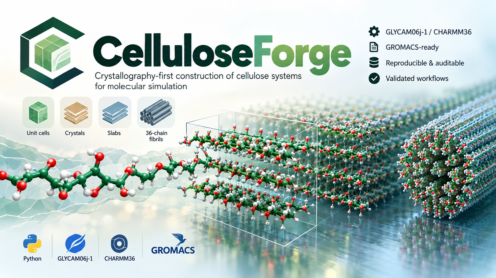

# CelluloseForge

CelluloseForge is a crystallography-first Python tool for building atomistic
cellulose structures. It generates periodic bulk crystals, chain-parallel
surface slabs for four cellulose allomorphs, and literature-defined 36-chain fibrils. Supported systems can
also be parameterized with GLYCAM06j-1 or CHARMM36 and written
directly for GROMACS. CHARMM36 topology generation does not require VMD or
`psfgen` at runtime.



> [!IMPORTANT]
> ## 🚧 Next-generation features are under active development
>
> Work is underway on **custom fibril cross-sections**, verified **18- and
> 24-chain fibril presets**, and additional simulation outputs for **Amber**,
> **OpenMM**, and **CHARMM/PSF** workflows. Odd-DP support is being considered
> separately. These capabilities are not part of the stable interface yet and
> will be released only after structural, topology, and cross-format
> validation. Feedback and contributions are welcome.

> **Release status:** CelluloseForge 1.1.2 is the current stable release. Its
> supported and validated boundaries below are intentionally narrower than the
> long-term project plan.

> **Geometry validation:** version 1.1.2 enforces right-handed slab orientation
> transforms and directly tests stereocentre preservation for supported
> allomorphs and reference faces.

## Key features

- Crystallographic datasets for cellulose I-alpha, I-beta, II, and III-I.
- Periodic bulk replication along the crystallographic `a`, `b`, and `c` axes.
- Chain-parallel slabs for I-alpha, I-beta, II, and III-I selected with signed
  Miller indices.
- Literature-defined 36-chain fibrils for I-alpha, I-beta, and II.
- Finite or covalently periodic cellulose chains.
- Deterministic chain and residue numbering.
- PDB and PDBx/mmCIF coordinate output.
- Automatic mmCIF fallback when a requested PDB exceeds 99,999 atoms.
- GLYCAM06j-1 parameterization through AmberTools and ParmEd.
- Direct finite- and periodic-chain CHARMM36 topology generation for GROMACS without VMD
  or `psfgen`.
- GROMACS `.gro` and `.top` output plus a machine-readable build report.
- Machine-readable diagnostics and deterministic outputs suitable for workflow
  managers and external LLM-based software agents.

## Current support

| Structure | Available allomorphs | Validation status |
|---|---|---|
| Unit cell | I-alpha, I-beta, II, III-I | Crystallographic cell, symmetry, and atom counts tested |
| Periodic bulk | I-alpha, I-beta, II, III-I | GLYCAM and CHARMM36 GROMACS preprocessing, minimization, and NVT stability tested |
| Slab | Chain-parallel faces for I-alpha, I-beta, II, and III-I | Finite and periodic GLYCAM/CHARMM36 matrices validated for I-alpha `(010)`, I-beta `(110)`, II `(110)`, and III-I `(110)` |
| 36-chain fibril | I-alpha, I-beta, II | Geometry presets tested; periodic GLYCAM and finite/periodic CHARMM36 GROMACS workflows validated |

The release supports finite and periodic GLYCAM and CHARMM36 output for GROMACS.
It excludes functionalization, native CHARMM/PSF output, and arbitrary
branched glycans. The CHARMM36 path generates GROMACS topology directly and
does not require VMD or `psfgen` at runtime.

## Table of contents

- [Requirements](#requirements)
- [Installation](#installation)
- [Verify the installation](#verify-the-installation)
- [Quick start](#quick-start)
- [Full tutorial](#full-tutorial)
- [Workflow-manager and LLM-agent orchestration](#workflow-manager-and-llm-agent-orchestration)
- [GLYCAM and GROMACS workflow](#glycam-and-gromacs-workflow)
- [CHARMM36 workflow](#charmm36-workflow)
- [Command reference](#command-reference)
- [Output files](#output-files)
- [Large systems](#large-systems)
- [Scientific conventions](#scientific-conventions)
- [Development and testing](#development-and-testing)

## Requirements

### Coordinate-only builds

- Python 3.11, 3.12, or 3.13
- NumPy 1.26 or newer, below 2.3

### GLYCAM/GROMACS builds

In addition to the coordinate-only requirements:

- AmberTools with `tleap`
- GLYCAM06j-1, distributed with AmberTools as `leaprc.GLYCAM_06j-1`
- ParmEd
- GROMACS for preprocessing, minimization, and simulation

AmberTools and ParmEd are not required when `--force-field none` is used.
GROMACS is not required to generate files, but it is required to validate and
simulate the generated system.

### CHARMM36/GROMACS builds

In addition to the coordinate-only requirements:

- Internet access for the one-time force-field download, or a local copy of
  the official pinned archive
- GROMACS for preprocessing, minimization, and simulation

AmberTools, ParmEd, VMD, and `psfgen` are not required for CHARMM36 builds.
CelluloseForge reads the official GROMACS CHARMM36 files directly.

## Installation

CelluloseForge is not yet released on PyPI. Install it from the GitHub
repository.

### Coordinate-only installation with uv

```bash
git clone https://github.com/askforarun/cellulose-forge.git
cd cellulose-forge
uv sync
uv run cellulose-forge --help
```

Install [uv](https://docs.astral.sh/uv/getting-started/installation/) first if
the `uv` command is unavailable.

### Coordinate-only installation with pip

```bash
git clone https://github.com/askforarun/cellulose-forge.git
cd cellulose-forge
python -m venv .venv
source .venv/bin/activate
python -m pip install --upgrade pip
python -m pip install -e .
cellulose-forge --help
```

On Windows PowerShell, activate the environment with
`.venv\Scripts\Activate.ps1`.

### Recommended GLYCAM installation

The repository provides an `environment.yml` containing CelluloseForge,
AmberTools, and ParmEd.
Create it from the repository root:

```bash
git clone https://github.com/askforarun/cellulose-forge.git
cd cellulose-forge
conda env create -f environment.yml
conda activate cellulose-forge
cellulose-forge doctor
```

AmberTools supplies `antechamber`, `parmchk2`, and `tleap`; the current GLYCAM
adapter uses `tleap`, while ParmEd converts and writes the matched GROMACS
topology. The editable package entry in `environment.yml` installs the local
CelluloseForge checkout, so run `conda env create` from the repository root.
GROMACS is not installed by this environment; install it separately when
preprocessing or simulation validation is required.

To update an existing environment after the file changes:

```bash
conda env update -n cellulose-forge -f environment.yml --prune
```

Users who only need coordinate generation or CHARMM36 construction may use the
lighter `uv` or `pip` installation above instead.

### Install the CHARMM36 force field

After installing CelluloseForge, download and install the supported official
CHARMM36/CGenFF release:

```bash
cellulose-forge forcefield install charmm36
```

When using the `uv` environment from this repository, run:

```bash
uv run cellulose-forge forcefield install charmm36
```

The installer downloads the pinned February 2026 CHARMM36/CGenFF 5.0 GROMACS
archive from the MacKerell Laboratory, verifies its SHA-256 checksum, validates
the required files, and installs it under the user data directory. Confirm the
exact path with:

```bash
cellulose-forge forcefield path charmm36
```

For an offline machine or compute cluster, first obtain the same official
archive and install from the local file:

```bash
cellulose-forge forcefield install charmm36 \
  --archive /path/to/charmm36-feb2026_cgenff-5.0.ff.tgz
```

Set `CELLULOSE_FORGE_DATA_DIR` before installation if the default
`~/.local/share/cellulose-forge` location is unsuitable. Normal builds discover
this installed release automatically; `--charmm-force-field-directory` is only
needed to override discovery deliberately.

Verify the external tools with one diagnostic command:

```bash
cellulose-forge doctor
```

`doctor` checks Python, NumPy, `tleap`, ParmEd, and GROMACS, reports which
build modes are ready, and suggests a fix for anything missing. Pass `--json`
for machine-readable output. GROMACS is commonly installed separately using
the package manager or module system appropriate to the workstation or
cluster. Consult the
[GROMACS installation guide](https://manual.gromacs.org/current/install-guide/index.html).

If ParmEd is installed in a different Python environment, pass its interpreter
with `--parmed-python /path/to/python` to both `doctor` and `build`. Likewise,
a non-default `tleap` can be selected with `--tleap-executable /path/to/tleap`.

## Verify the installation

```bash
cellulose-forge --version
cellulose-forge build --help
```

For a source checkout with development dependencies:

```bash
uv sync --extra dev
uv run pytest
uv run ruff check .
uv run mypy src
```

## Quick start

### Unit cell

```bash
cellulose-forge build \
  --allomorph I-beta \
  --shape unit-cell \
  --output ibeta_unit_cell.pdb
```

### Periodic bulk crystal

The values supplied to `--cells` are repetitions along the crystallographic
`a`, `b`, and `c` axes. Bulk geometry contains complete crystallographic unit
cells.

```bash
cellulose-forge build \
  --allomorph I-beta \
  --shape bulk \
  --cells 4 4 5 \
  --output ibeta_4x4x5_bulk.pdb
```

### I-beta `(110)` slab using exact counts

Degree of polymerization is the number of anhydroglucose units in each chain.
The current slab builder requires an even value. I-beta `(110)` slabs also
require an even `--chains-per-layer` so the transverse periodic box contains a
complete origin/center-chain lattice repeat. Dimension-based width requests
round upward to the next even chain count automatically.

```bash
cellulose-forge build \
  --allomorph I-beta \
  --shape slab \
  --face 1 1 0 \
  --layers 4 \
  --chains-per-layer 20 \
  --degree-polymerization 12 \
  --chain-boundary finite \
  --vacuum 30 \
  --output ibeta_110_slab.pdb
```

> **Finite-chain simulation boxes require longitudinal padding.** The
> `--vacuum` option pads the slab-normal direction; it does not separate the
> chemically capped chain ends from their periodic images. Before using a
> finite slab with GROMACS, supply at least 3 Å of chain-direction padding with
> `--padding-longitudinal` (for example, `--padding-longitudinal 20`). Without it, terminal atoms can
> overlap their periodic images and produce catastrophically large nonbonded
> energies. Values below 12 Å produce a warning because the ends may remain
> within a typical nonbonded cutoff; validated examples use 12--20 Å. Periodic
> chains must instead use zero longitudinal padding because
> their final and first residues are intentionally bonded across the box.

### I-beta `(110)` slab using physical dimensions

Dimensions are specified in angstrom. CelluloseForge rounds upward to complete
chains, molecular layers, and cellobiose repeats, and records the realized
dimensions in the output metadata.

```bash
cellulose-forge build \
  --allomorph I-beta \
  --shape slab \
  --face 1 1 0 \
  --slab-width 120 \
  --slab-thickness 25 \
  --slab-length 60 \
  --chain-boundary periodic \
  --vacuum 30 \
  --output ibeta_110_sized_slab.pdb
```

Sizing is selected independently for each axis. Supply exactly one option from
each pair: `--chains-per-layer` or `--slab-width`, `--layers` or
`--slab-thickness`, and `--degree-polymerization` or `--slab-length`. This
allows hybrid requests such as four exact layers with minimum 40 Å width and
40 Å chain length:

```bash
cellulose-forge build \
  --allomorph I-beta --shape slab --face 1 1 0 \
  --layers 4 --slab-width 40 --slab-length 40 \
  --chain-boundary finite --vacuum 30 \
  --output ibeta_110_hybrid.pdb
```

### Fibril cross-sections

```bash
cellulose-forge build \
  --allomorph I-beta \
  --shape fibril \
  --fibril-model 36-chain \
  --degree-polymerization 12 \
  --chain-boundary periodic \
  --vacuum 30 \
  --output ibeta_36chain_dp12.pdb
```

The preset is an explicit published chain arrangement, not an ideal regular
hexagon. Cellulose III-I has no supported 36-chain reference preset.

The development branch also provides I-beta 18- and 24-chain profiles:

```bash
cellulose-forge build \
  --allomorph I-beta --shape fibril \
  --fibril-model 18-chain \
  --degree-polymerization 12 --chain-boundary periodic \
  --vacuum 30 --output ibeta_18chain_dp12.pdb
```

The 18-chain profile is `2,3,4,4,3,2`; the 24-chain profile is
`3,4,5,5,4,3`. Rows are listed from low to high Cartesian `z`. A custom
profile within the validated I-beta 36-chain lattice envelope can be supplied
directly:

```bash
cellulose-forge build \
  --allomorph I-beta --shape fibril \
  --fibril-profile 1,2,3,2,1 \
  --degree-polymerization 12 --chain-boundary periodic \
  --vacuum 30 --output ibeta_custom_dp12.pdb
```

The 18-/24-chain and custom-profile paths currently support I-beta only. A
custom row list is a geometric request and is not described as a
literature-defined fibril unless its exact arrangement has a cited source.

For independent transverse box control, use `--padding-x` for Cartesian `x`
and `--padding-y` for the second transverse direction, Cartesian `z`. Both
values are total padding and are divided equally between opposite sides. For a
finite fibril, `--padding-longitudinal` controls total padding beyond the
chain ends along the chain axis:

```bash
cellulose-forge build \
  --allomorph I-beta \
  --shape fibril \
  --fibril-model 36-chain \
  --degree-polymerization 12 \
  --chain-boundary finite \
  --padding-x 30 \
  --padding-y 40 \
  --padding-longitudinal 20 \
  --output ibeta_36chain_finite_padded.pdb
```

For periodic chains, the y box length is fixed by the crystallographic repeat;
nonzero `--padding-longitudinal` is rejected because it would break the covalent bond
across the boundary. `--vacuum N` remains a shorthand that applies `N` total
padding to both transverse directions unless the corresponding option
overrides it. The historical `--padding-z` spelling is accepted as a
deprecated alias.

## Full tutorial

The [step-by-step tutorial](docs/tutorial.md) covers installation, unit cells,
bulk crystals, exact-count and dimension-based slabs, alternative faces,
36-chain fibrils, GLYCAM generation, GROMACS preprocessing and minimization,
large systems, visualization, chain numbering, and troubleshooting.

## Workflow-manager and LLM-agent orchestration

CelluloseForge does not embed an LLM, and an LLM is never required. Its
deterministic CLI, JSON diagnostics, and JSON build reports allow an external
workflow manager or software agent to use exactly the same documented commands
as a human. Check dependency availability in machine-readable form first:

```bash
cellulose-forge doctor --json
```

For example, an external agent can translate this request:

> Build a validated cellulose I-beta (110) slab with 4 layers, 20 chains per
> layer, DP 12, finite chains, 30 angstrom vacuum, and GLYCAM output.

into the following independently reproducible action:

```bash
cellulose-forge build \
  --allomorph I-beta \
  --shape slab \
  --face 1 1 0 \
  --layers 4 \
  --chains-per-layer 20 \
  --degree-polymerization 12 \
  --chain-boundary finite \
  --vacuum 30 \
  --padding-longitudinal 20 \
  --force-field glycam \
  --output ibeta_110_slab
```

The generated `build_report.json` records the interpreted scientific choices
and realized system, including a residue-level C1 chirality check confirming
D-cellulose geometry. Consumers should inspect that report and run the normal
validation workflow instead of trusting an agent's textual account. A retained
proof-of-concept record is available in
[`validation/agent_orchestration_demo/`](validation/agent_orchestration_demo/).

## GLYCAM and GROMACS workflow

Select `--force-field glycam` and provide an output directory instead of a
coordinate filename:

```bash
cellulose-forge build \
  --allomorph I-beta \
  --shape fibril \
  --fibril-model 36-chain \
  --degree-polymerization 12 \
  --chain-boundary periodic \
  --vacuum 30 \
  --force-field glycam \
  --output ibeta_fibril
```

CelluloseForge asks `tleap` to construct one GLYCAM chain, converts that
reference with ParmEd, maps the crystallographic coordinates into GLYCAM atom
order, and repeats the topology for the generated chains.

For cellulose II, the diffraction dataset does not contain hydroxyl-hydrogen
coordinates. GLYCAM output constructs HO2, HO3, and HO6 using the aligned
force-field hydroxyl directions and bond lengths; the experimental heavy-atom
coordinates remain unchanged. Origin and center chains are mapped in opposite
residue directions to preserve the allomorph's antiparallel connectivity. This
construction is recorded in `build_report.json`.

Preprocess a generated system with GROMACS:

```bash
gmx grompp \
  -f validation/periodic_pme_minim.mdp \
  -c ibeta_fibril/structure.gro \
  -p ibeta_fibril/system.top \
  -o ibeta_fibril/minim.tpr
```

Run energy minimization:

```bash
gmx mdrun -deffnm ibeta_fibril/minim
```

Use `validation/finite_pme_minim.mdp` for finite-chain systems and ensure that
the periodic box provides sufficient separation between chain ends.

### Selective chain position restraints

GLYCAM and CHARMM36 builds can apply GROMACS position restraints to the heavy
atoms of selected cellulose chains. Hydrogens remain unrestrained. Chain and transverse-layer IDs are deterministic, one-based
identifiers reported in `build_report.json`. Select explicit chains with
`--restrain-chains` or complete layers with `--restrain-layers`. The two
selectors are mutually exclusive. For example, this one-sided four-layer slab
restrains the heavy atoms in layers 1 and 2 while layers 3 and 4 remain fully
flexible:

```bash
cellulose-forge build \
  --allomorph I-beta \
  --shape slab \
  --face 1 1 0 \
  --layers 4 \
  --chains-per-layer 20 \
  --degree-polymerization 12 \
  --chain-boundary finite \
  --vacuum 30 \
  --padding-longitudinal 20 \
  --force-field glycam \
  --restrain-layers 1 2 \
  --restraint-force 1000 1000 1000 \
  --output restrained_4layer_slab
```

Slab and fibril layers are numbered from low to high Cartesian `z`. Fibril
cross-sections are displayed with the documented 90-degree counterclockwise
rotation, and their layers follow the explicit bottom-to-top rows of the
literature-defined preset. Within each fibril layer, chain IDs increase from
low to high Cartesian `x`. The generated topology separates free and restrained chains while
preserving the coordinate-to-topology order. The build report records the
layer-to-chain expansion and maps each selected chain ID to its GROMACS
molecule index and global atom range. Its `atom_selection` field records that
only heavy atoms in those chains are restrained.

Enable the restraints in the simulation MDP file:

```ini
define = -DPOSRES_CELLULOSE
```

Then pass the reference coordinates with `gmx grompp -r`:

```bash
gmx grompp \
  -f validation/position_restraint_pme_nvt_1ps.mdp \
  -c restrained_4layer_slab/structure.gro \
  -r restrained_4layer_slab/structure.gro \
  -p restrained_4layer_slab/system.top \
  -o restrained_4layer_slab/nvt.tpr
```

Omitting `-DPOSRES_CELLULOSE` disables the restraints without requiring a new
structure or topology. The three values supplied to `--restraint-force` are
the x, y, and z force constants in kJ mol$^{-1}$ nm$^{-2}$.

## Command reference

```text
cellulose-forge build --allomorph ALLOMORPH --shape SHAPE [OPTIONS] --output PATH
```

| Option | Values or units | Meaning |
|---|---|---|
| `--allomorph` | `I-alpha`, `I-beta`, `II`, `III-I` | Cellulose crystal allomorph |
| `--shape` | `unit-cell`, `bulk`, `slab`, `fibril` | Structure type |
| `--cells NA NB NC` | positive integers | Bulk repetitions along `a`, `b`, and `c` |
| `--face H K L` | signed integers | Slab Miller index; the index along the allomorph's chain axis must be zero |
| `--layers` | positive integer | Complete molecular layers in an exact-count slab |
| `--chains-per-layer` | positive integer | Chains in each exact-count slab layer |
| `--degree-polymerization` | positive even integer | Anhydroglucose units per chain |
| `--slab-width` | angstrom | Minimum transverse width |
| `--slab-thickness` | angstrom | Minimum thickness normal to the surface |
| `--slab-length` | angstrom | Minimum chain-direction length |
| `--fibril-model` | `18-chain`, `24-chain`, `36-chain` | Named fibril preset; 18/24 currently require I-beta |
| `--fibril-profile` | comma-separated positive integers | Custom I-beta row counts from low to high Cartesian z |
| `--chain-boundary` | `finite`, `periodic` | Terminal groups or a covalent bond across the chain boundary |
| `--vacuum` | angstrom | Total transverse vacuum padding |
| `--padding-x` | angstrom | Total fibril x padding; overrides `--vacuum` for x |
| `--padding-y` | angstrom | Total fibril padding in its second transverse direction (Cartesian z); overrides `--vacuum` |
| `--padding-longitudinal` | angstrom | Total chain-axis padding; periodic chains require zero |
| `--padding-z` | angstrom | Deprecated alias for `--padding-longitudinal` |
| `--force-field` | `none`, `glycam`, `charmm36` | Coordinate-only construction or molecular-mechanics parameter set |
| `--md-engine` | `gromacs`, `amber`, `openmm` | Target engine; repeat for multiple outputs |
| `--topology-format` | `gromacs`, `amber`, `both` | Deprecated compatibility alias for GLYCAM builds |
| `--tleap-executable` | executable path | `tleap` used for GLYCAM builds |
| `--parmed-python` | Python path | Interpreter containing ParmEd |
| `--charmm-template` | ITP path | Optional periodic reference topology for regression studies |
| `--charmm-force-field-directory` | directory | Optional override for the installed CHARMM36 release |
| `--restrain-chains` | one or more IDs | Restrain selected deterministic chain IDs |
| `--restrain-layers` | one or more IDs | Restrain geometry-defined transverse layers |
| `--restraint-force` | `FX FY FZ` | Position-restraint force constants in kJ mol$^{-1}$ nm$^{-2}$ |
| `--output` | file or directory | Coordinate file for `none`; directory for force-field builds |

Run `cellulose-forge build --help` for the authoritative parser help.

## CHARMM36 workflow

Install the pinned official February 2026 CHARMM36/CGenFF 5.0 GROMACS port once:

```bash
cellulose-forge forcefield install charmm36
```

Build a finite cellulose I-beta (110) slab with native CHARMM36/GROMACS
topology:

```bash
cellulose-forge build \
  --allomorph I-beta \
  --shape slab \
  --face 1 1 0 \
  --layers 4 \
  --chains-per-layer 20 \
  --degree-polymerization 12 \
  --chain-boundary finite \
  --vacuum 30 \
  --padding-longitudinal 20 \
  --force-field charmm36 \
  --output ibeta_110_charmm36
```

The output directory contains `structure.gro`, `structure.pdb` (or mmCIF for
large systems), `cellulose_charmm36.itp`, `system.top`, the pinned local
force-field files, and `build_report.json`. Preprocess it with:

```bash
gmx grompp \
  -f validation/finite_pme_minim.mdp \
  -c ibeta_110_charmm36/structure.gro \
  -p ibeta_110_charmm36/system.top \
  -o ibeta_110_charmm36/minim.tpr

gmx mdrun -deffnm ibeta_110_charmm36/minim
```

The installer verifies the archive checksum and records a stable local release;
upstream updates are adopted only through an explicit CelluloseForge update.
CelluloseForge reads `BGLC` from the installed force field, applies finite or
cyclic `14bb` linkages, and writes matched GRO/ITP/TOP output
directly without a reference-chain ITP, VMD, or `psfgen`. See
the [full tutorial](docs/tutorial.md#11-generate-charmm36gromacs-systems) for
finite and periodic examples and [`docs/charmm36.md`](docs/charmm36.md) for
the implementation and validation evidence.

## Output files

### Coordinate-only mode

The filename extension selects PDB or PDBx/mmCIF. Every coordinate-only build
also writes a sibling `<structure>.build_report.json` containing the interpreted
geometry, chain count, derived degree of polymerization, and actual coordinate
filename:

```text
structure.pdb
structure.build_report.json
structure.cif
structure.mmcif
```

When physical slab dimensions are requested, the report records both the
requested and realized dimensions in `geometry_annotations`. The reported DP
is the even number of anhydroglucose units obtained by rounding the requested
chain-direction length upward to complete cellobiose repeats.

### GLYCAM mode

```text
ibeta_fibril/
├── structure.pdb       # or structure.cif for more than 99,999 crystal atoms
├── structure.gro       # GROMACS coordinates
├── system.top          # standalone GROMACS topology
└── build_report.json   # inputs, provenance, counts, and generated files
```

Native Amber files can be requested instead of, or alongside, GROMACS files:

```bash
cellulose-forge build \
  --allomorph I-beta --shape fibril --fibril-model 18-chain \
  --degree-polymerization 12 --chain-boundary finite --vacuum 30 \
  --padding-longitudinal 20 \
  --force-field glycam --md-engine gromacs --md-engine amber \
  --output ibeta_18chain_glycam
```

With both engine selectors, the directory contains
`structure.prmtop` and `structure.inpcrd`. These files describe the complete
multi-chain system and use the same mapped coordinates, periodic box, GLYCAM
charges, and bonded topology as the GROMACS output. The build report records a
ParmEd reload check of atom count, residue count, total charge, and box.
Native Amber output currently supports finite chains only. Covalently periodic
chains remain available through GROMACS because Amber does not minimum-image a
bonded interaction crossing the chain-direction box boundary.
See [`docs/amber.md`](docs/amber.md) for the format semantics and engine-level
validation boundary.

### OpenMM mode

Finite GLYCAM systems can be emitted and checked directly with OpenMM:

```bash
cellulose-forge build \
  --allomorph I-beta --shape fibril --fibril-model 18-chain \
  --degree-polymerization 12 --chain-boundary finite --vacuum 30 \
  --padding-longitudinal 20 --force-field glycam \
  --md-engine openmm --output ibeta_18chain_openmm
```

Install the optional Python dependency with `pip install 'cellulose-forge[openmm]'`
or use `environment.yml`. The output contains complete `structure.prmtop` and
`structure.inpcrd` files plus `run_openmm.py`. During construction,
CelluloseForge loads the files in OpenMM, verifies finite potential energy, and
performs a ten-iteration minimization smoke test. Engine version, platform, and
energies are recorded in `build_report.json`. Use `--openmm-python` when OpenMM
is installed under a different interpreter. See
[`docs/openmm.md`](docs/openmm.md).

Existing scripts using `--topology-format gromacs|amber|both` remain valid but
emit a deprecation warning. New workflows should use `--md-engine`.

## Large systems

PDB atom serial numbers are limited to five columns. If a requested PDB would
contain more than 99,999 atoms, CelluloseForge writes a sibling `.cif` file and
prints its path. It never silently truncates or wraps a PDB.

For a parameterized system exceeding this limit:

- use `structure.cif` for visualization and unambiguous identifiers;
- use `structure.gro` with `system.top` for GROMACS;
- use the compiled `.tpr` for simulation.

GRO atom and residue identifiers are also five-column fields and therefore wrap
for very large systems. GROMACS reads the coordinate records in topology order,
but mmCIF should be used when unique human-readable identifiers matter.

A finite I-beta `(110)` reference slab with 100,800 crystallographic atoms was
mapped to 102,000 GLYCAM atoms and passed GROMACS 2024.2 `gmx grompp` with PME,
zero warnings, and no `-maxwarn` allowance.

## Scientific conventions

### Slab orientation

Slabs use a simulation-oriented Cartesian frame compatible with GROMACS
semi-isotropic pressure coupling:

- transverse surface direction: `x`;
- cellulose chain direction: `-y`;
- outward surface normal and vacuum direction: `-z`.

The requested face is the low-`z` surface. Layers increase toward high `z`, and
chains within a layer are ordered from low `x` to high `x`.

### Chain identifiers

Chains have stable one-based numeric identifiers. PDB one-character chain labels
are reused after 62 chains, while the segment field records `C001`, `C002`, and
so on. Use numeric chain mappings or mmCIF identifiers for restraints and
analysis of large systems.

### Slab faces

The validation matrix covers I-alpha `(010)`, I-beta `(110)`, II `(110)`, and
III-I `(110)` with finite and periodic GLYCAM06j-1 and CHARMM36 systems.
Additional chain-parallel faces are generated by the same reciprocal-lattice,
whole-chain construction and should be checked for the intended application.
Following the Cellulose-Builder convention for I-beta,
`(100)` and `(010)` expose origin-chain layers, whereas `(200)` and `(020)`
expose center-chain layers halfway through the unit cell.

## Development and testing

```bash
uv sync --extra dev
uv run pytest --cov=cellulose_forge --cov-report=term-missing
uv run ruff check .
uv run mypy src
```

Continuous integration tests Python 3.11 and 3.13 on Linux and macOS.

## License

CelluloseForge is distributed under the GNU General Public License, version 3
or later. See [LICENSE](LICENSE) or [Licence.txt](Licence.txt).
