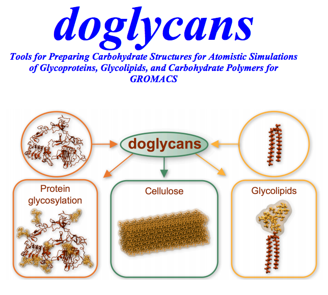

#doglycans Tool version 1.0


##doglycans free software:

The doglycans tool set is a free software package and can be redistributed and/or modified under the terms of the GNU General Public License as published by the Free Software Foundation, version 3 of the License.  For more details, see 

https://www.gnu.org/licenses/gpl-3.0.en.html		

The doglycans source code can be downloaded from 

https://bitbucket.org/biophys-uh/doglycans.git

For more information on the research activities of the team standing behind the tool, please visit the webpage 

https://www.helsinki.fi/en/researchgroups/biophysics 	


##Disclaimer:

The programs and scripts provided in the doglycans package are 'as-is', without any express or implied warranty. In no event will the authors be held liable for any damages arising from the use of this software. The doglycans tool and the manual will be updated if any additional features are added to the tool. The users are requested to always use the latest version of the tool. Any comments or issues in the usage of the tool can be posted by creating an issue in the doglycans public repository:

https://bitbucket.org/biophys-uh/doglycans/

##Citing doglycans

Reinis Danne, Chetan Poojari, Hector Martinez-Seara, Sami Rissanen, Fabio Lolicato, Tomasz Róg, Ilpo Vattulainen. doglycans.py – Tools for Preparing Carbohydrate Structures for Atomistic Simulations of Glycoproteins, Glycolipids, and Carbohydrate Polymers with GROMACS. J. Chem. Inf. Model. (2017) [Please update the reference not known in full at the time of writing this manual]. 


#######################################################################################################


#Installation of the doglycans tool

The dependencies can be installed by using one of the following two methods:

##1.1) Installation of dependences

##1.1a) Recommended installation using Anaconda Cloud:

Anaconda is a self-contained and customizable python distribution and its libraries can be downloaded from its web page:

https://www.continuum.io/downloads 

Please download the latest python 3.X version of the package and install it.

```
sh Anaconda3-4.3.1-Linux-x86_64.sh
```

At the end of the installation process you will be offered to prepend the Anaconda3 install location
to your path. This is required to have access to the executables. This essentially appends these two lines to the ~/.bashrc or ~/.bash_profile for Mac OS X systems

```
# added by Anaconda3 X.X.X installer
export PATH="/INSTALL_PATH/anaconda3/bin:$PATH"
```

Although this is fine for most of the users, some can experience some problems. This is because essentially your default python interpreter will be replaced by the one shipped to anaconda. This can be avoided by reverting the look up order:

```
# added by Anaconda3 X.X.X installer
export PATH="$PATH:/INSTALL_PATH/anaconda3/bin"
```

After this we will create a customized environment to run the doglycans tools:

```
conda create --name doglycans "python>=3.6" "numpy=1.13.1" "ply>=3.10"
```

To enter to the doglycans environment we type:

```
source activate doglycans
```

We will finish customizing the environment by installing openbabel in it:

```
conda install -c openbabel openbabel=2.4.1
```

To exit the doglycans environment once you are done, either close the used terminal or type:

```
source deactivate doglycans
```


##1.1b) Manual installation:

For manual installation, the users are required to install the following dependencies to run the doglycans tool. We expect users to have PYTHON 3 (>3.6) installed (the doglycans tool was tested with PYTHON 3.6).

```
•	swig-3.0.12 or greater (for openbabel python bindings)
•	openbabel 2.4.1 or greater
•	numpy 1.13.1 or greater
•	ply 3.10 or greater
```

Please see the REFERENCES.txt file for their relative web pages.


##1.2) Downloading, installing and running the doglycans tool

Following the successful installation of the dependencies, the users are ready to use doglycans tool to glycosylate their systems. You just need to download the latest version from: 

https://bitbucket.org/biophys-uh/doglycans/

Notice that the program is self-contained in the folder together with the examples. Do not alter the content of the folder or move it out of the folder as it will not work.

It is recommended to add a variable pointing to the folder path to avoid writing the path several times per command. For this add to you .bashrc or .profile ( This is assumed in the examples given below):

```
# doglycans path
DGPATH="/PATH/TO/doglycans/"

```

To run the doglycans execute the desired script within the newly created environment:

```
source activate doglycans
python $DGPATH/PROGRAM.py [options]

```

##1.3) Additional Dependencies for running the examples and test:

As the doglycans tool generates input files for simulations to be carried out in the GROMACS molecular dynamics (MD) simulation package, for taking advantage of it functionality the users should have the molecular dynamics simulation package GROMACS installed.

GROMACS can be found in http://www.gromacs.org/Downloads.

All examples presented here have been prepared to be run in Gromacs 4.6.x. Newer versions require minor changes in the parameters files, i.e. mdp files. 
